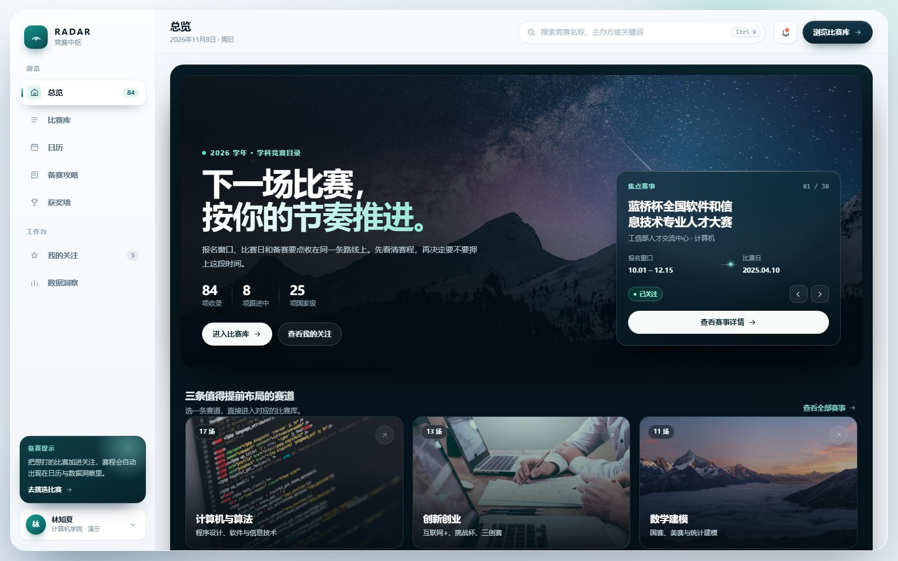
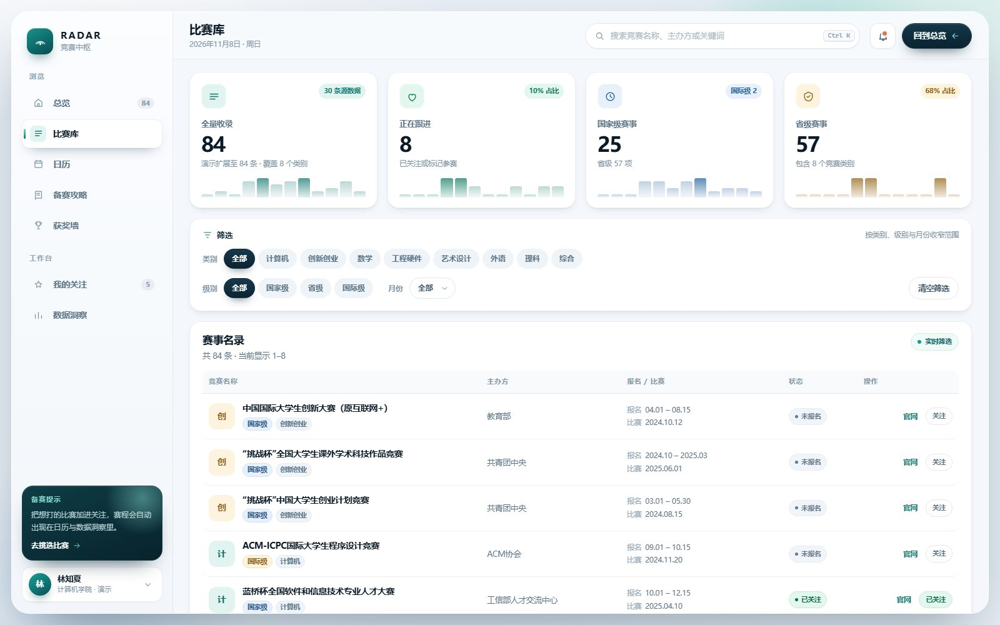
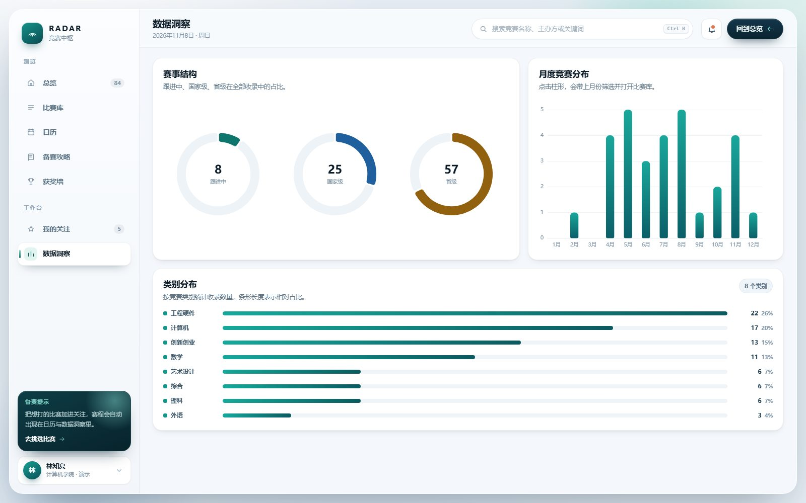
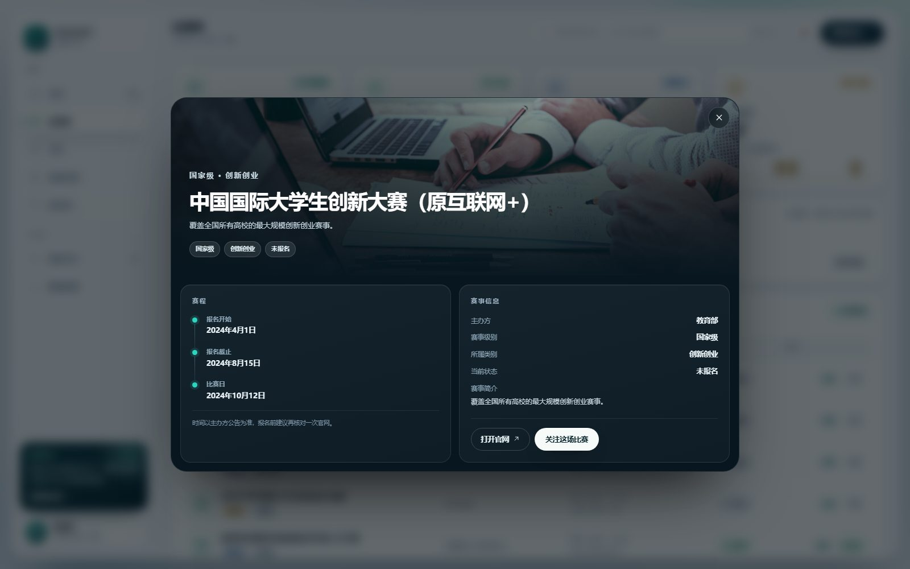

# 🏆 RADAR · 校园竞赛信息平台 v2.0

原生 HTML / CSS / JavaScript 实现的校园竞赛信息聚合平台。以「深色电影感总览 + 浅色专业工作台」双主题重构，包含多维筛选、分页、日历、图表联动、赛事详情弹层与关注本地持久化，无构建步骤、无框架依赖。



## ✨ 本次升级重点

- **设计系统**：深海青 + 石墨蓝 + 暖金配色，彻底移除默认紫色渐变；统一圆角、分层阴影与 `cubic-bezier` 缓动。
- **总览页**：2000px 山景大图、渐变标题、毛玻璃焦点赛事卡（可上一场 / 下一场）、三条赛道影像卡、正在跟进列表。
- **比赛库**：4 张统计卡（含月度迷你趋势图）、分段筛选器、带类别缩略图与状态徽标的数据表格、数字页码分页。
- **赛事详情**：深色毛玻璃弹层，按赛事类别切换封面，报名 / 比赛时间轴，信息表，官网与关注操作。
- **生产细节**：`#/library` 等深链接、`localStorage` 关注持久化、外链协议白名单、`Ctrl/⌘ + K` 聚焦搜索、空状态与加载失败提示。
- **响应式与可访问性**：≤1024px 侧栏改为抽屉，≤700px 单列布局；skip link、`aria-current`、`aria-pressed`、弹窗焦点陷阱、`prefers-reduced-motion` 降级。

## 🖼 页面预览

| 比赛库 | 数据洞察 |
| --- | --- |
|  |  |



## 🚀 快速启动

项目通过 `fetch` 读取 `data/data.json`，需要本地 HTTP 服务，直接双击 `index.html` 会被浏览器安全策略拦截。

```bash
# 任选其一
python -m http.server 8765
npx serve .
```

然后访问 `http://localhost:8765`。使用 VS Code 的 Live Server 插件同样可以。

深链接可直接进入页面：

```text
http://localhost:8765/#/home
http://localhost:8765/#/library
http://localhost:8765/#/calendar
http://localhost:8765/#/guide
http://localhost:8765/#/awards
http://localhost:8765/#/follow
http://localhost:8765/#/insight
```

## 📂 目录结构

```text
CompetitionPlatform/
├── index.html            # 页面骨架：侧边栏、顶栏、7 个页面视图、详情弹层、Toast
├── css/
│   └── style.css         # 设计令牌、深色 / 浅色两套界面、组件、响应式
├── js/
│   └── app.js            # 数据加载、筛选分页、焦点轮播、日历、ECharts、弹窗、路由
├── data/
│   └── data.json         # 30 条真实赛事，演示时自动扩展至 84 条
├── preview/              # README 使用的界面截图
└── README.md
```

## 🎨 设计令牌

样式集中在 `css/style.css` 顶部的 `:root`，改主题只需改这一处：

| 令牌 | 值 | 用途 |
| --- | --- | --- |
| `--brand-600` | `#0f766e` | 品牌主色（深海青） |
| `--brand-300` | `#7fd3c9` | 深色界面上的强调色 |
| `--ink-900` | `#0a1a26` | 主要文字 |
| `--ink-500` | `#5b7386` | 次要文字 |
| `--surface` | `#ffffff` | 卡片表面 |
| `--workspace` | `#f4f7fb` | 工作台底色 |
| `--shadow-md` | 双层阴影 | 卡片 hover 抬升 |
| `--r-lg` / `--r-xl` | `18px` / `24px` | 卡片与容器圆角 |

阴影统一采用「近实远虚」的两层结构，避免灰蒙蒙的大范围投影；所有可点击卡片都有 `translateY(-1px ~ -5px)` 的 hover 反馈。

## ⚙️ 功能

- 四维筛选：类别、级别、月份、关键词，实时更新结果与筛选摘要。
- 分页：每页 8 条，带省略号的页码窗口与前后翻页。
- 赛事详情：弹层展示赛程时间轴、主办方、级别、类别、简介与官网。
- 关注：列表行、弹窗内均可切换，写入 `localStorage`（`radar.follows.v1`），刷新后保留。
- 日历：报名起止与比赛日分类着色，可翻月；自动定位到有赛程的月份。
- 数据洞察：ECharts 环形图 + 月度柱状图（点击柱形联动月份筛选），以及纯 CSS 的类别分布条形图。
- 搜索：顶栏关键词实时过滤，`Ctrl/⌘ + K` 快捷聚焦。
- 响应式：1024px 抽屉导航、860px 顶栏换行、700px 单列卡片、表格横向滚动。

## 🗂 数据格式

`data/data.json` 为数组，字段如下：

```json
{
  "id": 5,
  "name": "蓝桥杯全国软件和信息技术专业人才大赛",
  "category": "计算机",
  "level": "国家级",
  "host": "工信部人才交流中心",
  "signTime": "2024-10-01 至 2024-12-15",
  "compTime": "2025-04-10",
  "website": "https://dasai.lanqiao.cn/",
  "intro": "全国性IT学科赛事，重点考察算法与编程。",
  "status": "关注"
}
```

`status` 支持 `未参与`、`关注`、`参与`、`已结束`。日期统一使用 `YYYY-MM-DD`，`signTime` 可包含起止两个日期，日历与详情会分别解析。

## 🚢 生产部署建议

- 将 ECharts 与 Unsplash 图片改为自托管静态资源，或接入自己的 CDN，避免外部网络波动影响首屏。
- 用真实后端接口替换 `fetch("./data/data.json")`，并把关注状态接入账号体系（`localStorage` 仅适合单机演示）。
- 为图片增加 `width/height` 或本地压缩版本，进一步优化 LCP。
- 若部署在子路径，深链接使用 `history.replaceState` 修改 hash，无需额外的服务端 rewrite。

## ✅ 兼容性

面向现代浏览器（Chrome / Edge / Firefox / Safari 16+）：使用 CSS Grid、`backdrop-filter`、`text-wrap: balance`、`dvh` 与 ECharts 5。已提供 `prefers-reduced-motion` 与触屏 hover 降级。
